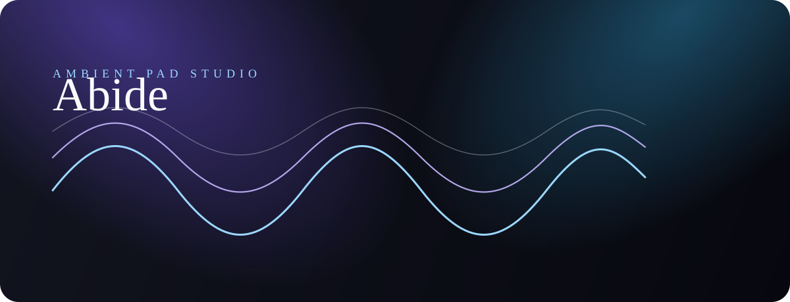

<div align="center">



<br>

**Hold one chord long enough for a room to settle.**

A browser instrument for prayer, rehearsal, and the quiet minutes before a song starts.
Sound is made on this device. Nothing is uploaded.

</div>

---

## Play

Open the studio, press **Play**, and leave the chord up. Shared notes stay held when you change chords. New tones swell in instead of clicking on.

| | |
| --- | --- |
| **Space** | Play, or let the pad release |
| **M** | Mute |
| **Fade in / Fade out** | The whole pad arrives and leaves slowly |
| **Keys** | C through B |
| **Chords** | Major, minor, 7ths, sus2, sus4, add9, and 9ths |
| **Transpose** | Shift the sounding key without losing your place |

The master volume stays where you set it when you change presets.

Phones and some browsers stay silent until the first tap. **Play** or **Fade in** is that tap.

## The room

Four places, one sitting.

**Perform.** The chord you are hearing, the keys, and the transport.

**Layers.** Up to four sounds at once. Each layer has its own volume, tone, attack, release, reverb, delay, and width.

**Space.** One set of controls for the whole stack: reverb, delay, low-pass, high-pass, stereo width, attack, release, and fade time.

**Presets.** Eight starting sounds, plus anything you save in this browser. Rename a saved preset, delete one, or clear them all.

## Presets

| Preset | What it is |
| --- | --- |
| Warm Worship Pad | A rounded synth pad. Soft saw warmth under a steady tone. |
| Deep Atmosphere | A low organ tone. Slow, still, and close. |
| Soft Piano Pad | A soft bell with a felt attack. Drier than the pads. |
| Ethereal Choir | A hummed vowel, low and warm. |
| Cinematic Worship | The pad slowly opens and closes. |
| Ambient Strings | A soft bowed tone, a little brighter. |
| Heavenly Atmosphere | Choir and piano together. The brightest of the set. |
| Dark Drone | A low tone with a muffled pulse underneath. |

## Run it

You need Node.js.

```bash
npm install
npm run dev
```

Vite prints a local address. Open it.

```bash
npm run build
npm run preview
```

`build` typechecks, then writes the static site to `dist`.

## What it is made of

React, TypeScript, and Vite for the studio. Tailwind for the room. Zustand for the session. The Web Audio API for every tone: no sample library, no account, no server.

Custom presets and the last session stay in `localStorage` on this browser.

<div align="center">

<sub>Abide. Stay with the chord.</sub>

</div>
